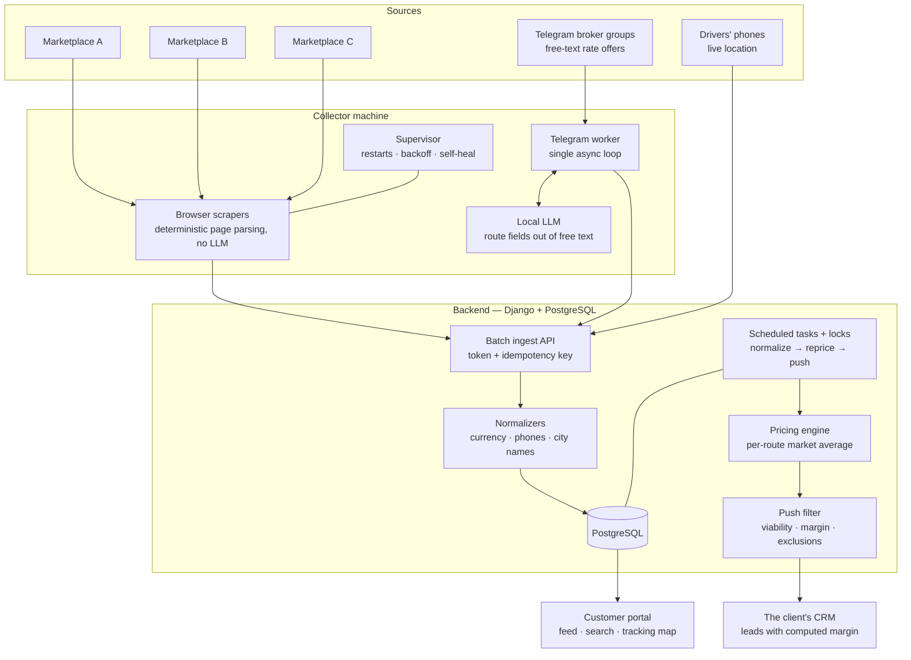

# Freight Data Pipeline — Scraping, Pricing and CRM Automation

A road-freight broker buys and sells truckloads on a long-haul cross-border
corridor. Three load marketplaces and several dozen Telegram broker groups
publish thousands of freight offers a day between them — the marketplaces as
web pages, the groups as free text typed by dispatchers. This system reads all
of it continuously, turns it into structured records, prices each route from
the offers it has seen, and pushes only the loads worth quoting into the sales
team's CRM as leads carrying a computed margin. A second half tracks trucks
already moving and shows customers where their cargo is.

I inherited it unfinished and undocumented, and was its sole engineer:
scrapers, backend, Telegram ingestion, CRM integration, portal, and the
machines it runs on. Below are four problems I found and fixed. Every number
was measured; where I never measured an "after", I say so.

## Architecture

The two halves are coupled only by one authenticated batch endpoint over TLS —
no shared database, no queue, no file sync. The language model is used in one
narrow place. Marketplace pages are structured and parsed deterministically;
Telegram posts are prose with emoji, and the model earns its place picking
origin and destination out of them. The price is *not* read by the model.

## Case study 1 — Scrapers that were alive but had stopped working

**Problem.** One scraper harvested nothing for about two hours and would never
have recovered on its own. The alerts were not broken — ten error-severity
reports had fired. But the process caught the exception inside its own loop and
stayed alive, and the supervisor only restarts children that *exit*. Detection
worked; recovery did not exist. The same failure mode had earlier cost 51 hours
of downtime on one source.

**How I found it.** The error text was generic: "page did not become ready
within 60 seconds", which is also what a network outage produces. The host
numbers told the real story: the scraper reused one browser indefinitely and it
had grown to 8.5 GB on a 32 GB machine, leaving 0.06 GB free with 4.9 of 6 GB
of swap in use. Killing the child freed 8.7 GB and the next cycle harvested 47
backlogged loads. The watchdog had been measuring the Python process (205 MB),
not the browser in its own process tree (3,281 MB when I checked).

**Fix.** A consecutive-failure counter exits the process after five failed
cycles, so the supervisor relaunches it with a fresh browser. The exit
threshold sits deliberately above the alert threshold: restarting sooner would
reset the streak before the alert escalated, making a breakage quieter. The
watchdog now sums the process group, and all three sources share one
cycle-health counter.

**Result.** Stalls now recover automatically. No post-fix downtime figure was
recorded, so I claim none.

## Case study 2 — A health check that treated "running" as "healthy"

**Problem.** One scraper lost its session and made 1,252 failed login attempts
in 24 hours — 191 the day before — across 96 restarts. Monitoring never
mentioned it; the client asked whether the source was down.

**How I found it.** Each failed login left one dated screenshot artefact, so
counting them gave the figure directly. There were three causes, and fixing any
one alone would have changed nothing: the pause between attempts was a fixed
random interval; the failure streak lived only in process memory, so every
restart began again at a short pause; and — the main one — the supervisor
treated any run longer than a minute as healthy and reset the pause to five
seconds. One run lived 926 seconds doing nothing but failing logins, and
counted as healthy.

**Fix.** The backoff now resets only on proof — a clean exit code, or a run
longer than an hour — grows exponentially, and survives restarts.

**Result.** At most 29 attempts a day. That figure comes from re-simulating the
same outage against the current code in the test suite (19 tests), not from
production. The test mattered: an intermediate fix without the persisted streak
still gave 185 attempts. The same self-feeding retry loop on another source had
earlier turned a site-wide rate limit into a block its own retries kept alive —
350 attempts over 20 hours, now 24.

## Case study 3 — Failure reports rejected in silence

**Problem.** 5,101 failure reports from one scraper had been rejected by the
backend and lost.

**How I found it.** I was chasing why alerts for a visible breakage never
arrived. The reports were being sent; the backend was answering 400 and nobody
was reading the response. The exception raised at that failure point
stringifies to an empty string, so each report carried an empty message field,
the ingest endpoint correctly rejected it as invalid, and the sender treated
the rejection as nothing.

**Fix.** One shared message builder for both sources that can never produce an
empty message, plus a guard in the reporting function. No after-count was
measured, so this is a structural fix, not a number.

## Case study 4 — Measuring the funnel instead of guessing at it

**Problem.** Only 7 leads a day reached the CRM; the client wanted 100 to 200.
The first hypothesis — mine included — was that deduplication was too
aggressive.

**How I found it.** I counted every stage of the push over 24 hours: 4,418
records created, and the *source gate* cut that to 7. Everything downstream
barely filtered at all (7 → 7 → 7 → 7 → 6). Deduplication, the already-sent
guard, the viability rules and the per-run cap were none of them the
bottleneck.

**Fix.** The gate was configuration: one productive source had never been
switched on.

**Result.** A dry run of the real scheduled task gave 37 eligible and 25 pushed
per run while the backlog drained, settling at 35 to 40 leads a day. I also
reported the honest ceiling: with the current routing rules the realistic
maximum is about 40 a day, and the only lever that reaches the client's target
is a commercial decision, not a code change.

Two adjacent measurements. The hourly repricing job went from 68 minutes a run
to 135 seconds, because price depends only on the city pair: 5,787 routes
rather than 158,189 open records, writing only changed rows, with a lock
against overlapping runs — 636 sampled records, 0 mismatches against the old
per-record calculation. And the local model was losing the amount on 31% of
priced blocks (834 requests in 24 hours), sometimes returning cargo weight
instead of the rate; the price is now parsed deterministically from the
currency-anchored number.

## Lessons

- **Alive is not healthy.** A process can spend an hour doing nothing but
  failing. Uptime and a quiet log are not health signals; proof of useful work
  is.
- **An alert nobody acts on is not monitoring.** In three of these four cases
  detection already worked and recovery simply did not exist — including a
  sender told "invalid" 5,101 times that shrugged every time.
- **Measure the whole funnel before fixing any stage of it.** The bottleneck
  was in the stage nobody suspected; the stage everyone blamed was innocent.
- **Prefer simple deterministic code where the data must be exact.** A language
  model is good at reading a route out of prose and bad at being trusted with a
  number. Parse the number; ask the model for the prose.
